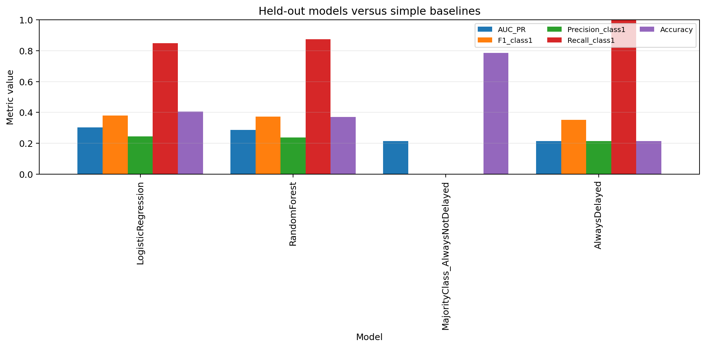
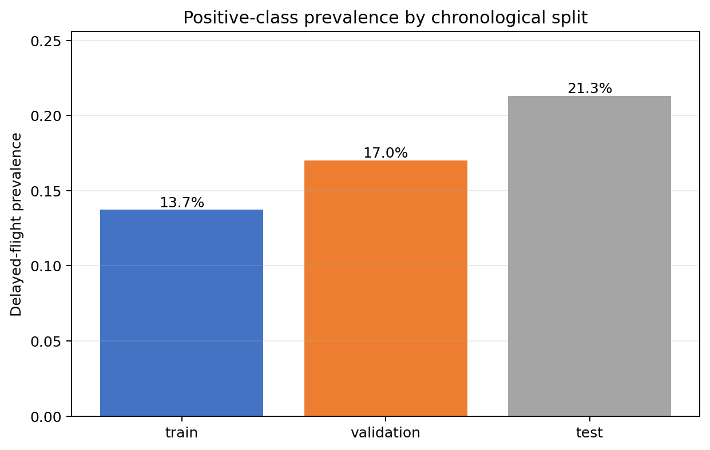
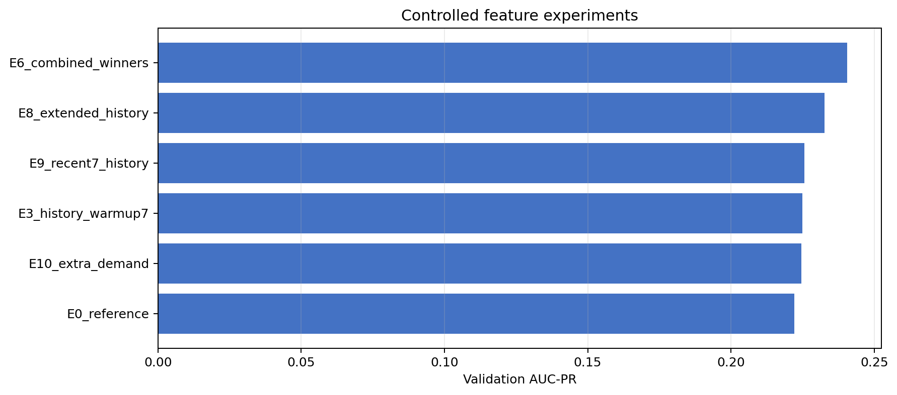
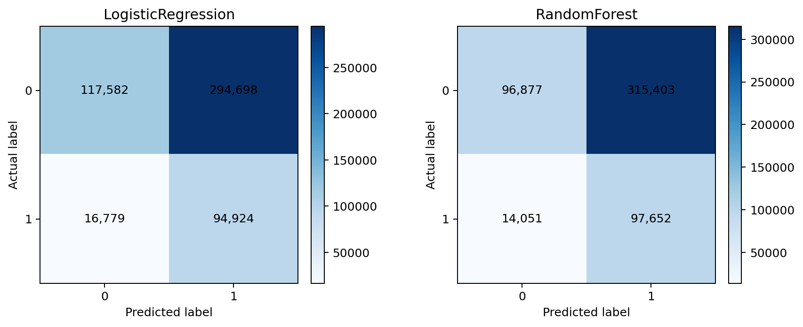
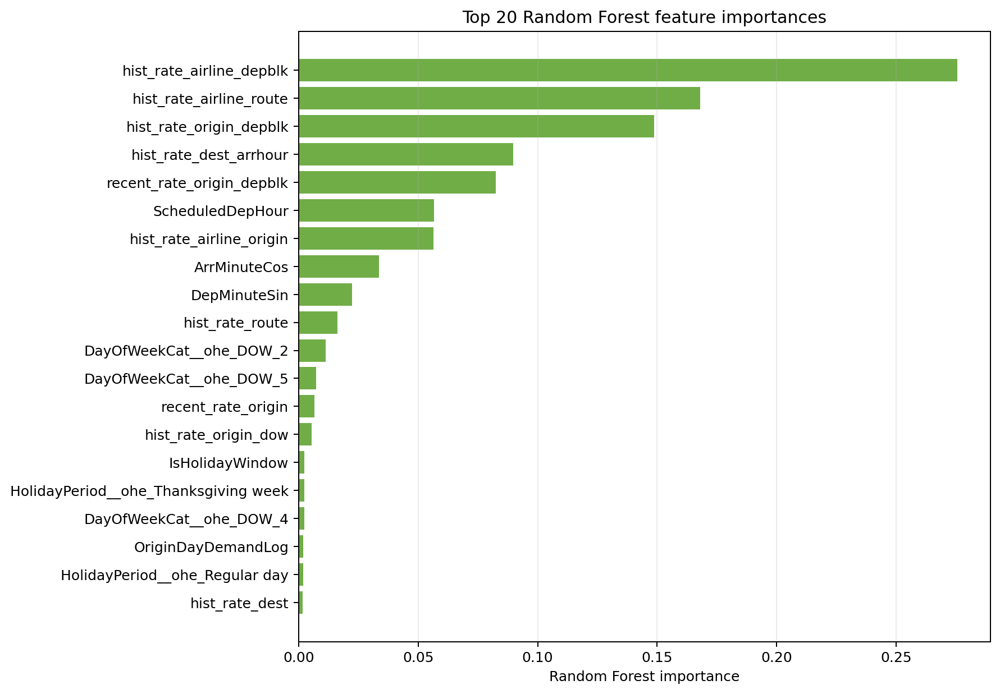

# Actual-data ML results

Run date: 2026-10-30. These are measured results from the supplied 1,781,482-row Parquet dataset, not synthetic or assumed values.

## Outcome

The leakage-controlled pipeline completed successfully on Spark 3.5.9/YARN with both worker containers. The final feature configuration improved validation PR-AUC from 0.22218 to 0.24054 under the controlled fixed-LR comparison. After all decisions were frozen, Logistic Regression outperformed Random Forest on the held-out test by both ranking and threshold metrics.

| Final held-out metric | Logistic Regression | Random Forest |
|---|---:|---:|
| Validation-selected threshold | 0.11 | 0.12 |
| ROC-AUC | **0.62664** | 0.60936 |
| PR-AUC | **0.30359** | 0.28687 |
| F1 (delayed class) | **0.37869** | 0.37218 |
| Precision (delayed class) | **0.24363** | 0.23641 |
| Recall (delayed class) | 0.84979 | **0.87421** |
| Accuracy | **0.40556** | 0.37125 |

Accuracy is not the optimization target. The validation-F1 thresholds intentionally flag many flights to recover 85–87% of delayed flights. The majority-class baseline has 78.68% accuracy but detects no delayed flights; it has zero recall and zero F1.

## Data and split

Eligibility removes 13,064 cancelled and 3,139 diverted flights and requires a binary `ArrDel15`, leaving 1,765,279 rows. The detailed integrity, schema, null and holiday-join checks are in [DATA_VALIDATION_REPORT.md](DATA_VALIDATION_REPORT.md).

| Split | Dates | Flights | Positive | Prevalence |
|---|---|---:|---:|---:|
| Train | 2024-10-01–2024-11-24 | 1,067,747 | 146,735 | 13.74% |
| Validation | 2024-11-25–2024-12-03 | 173,549 | 29,526 | 17.01% |
| Test | 2024-12-04–2024-12-31 | 523,983 | 111,703 | 21.32% |

The increasing positive rate is material temporal shift. All feature, model, hyperparameter and threshold decisions were frozen before test eligibility or labels were read.

## Pipeline and selected configuration

The selected predictors use only pre-departure information:

- cyclic scheduled departure/arrival time, scheduled hour, elapsed time and distance;
- carrier, origin, destination, departure block and weekday encodings;
- holiday calendar flag/category;
- schedule-only destination-hour, origin-day and previous-hour demand counts, calculated over all scheduled flights;
- smoothed historical rates for carrier, airport, route and schedule interactions;
- recent 7-day rates for carrier, origin and origin/departure-block.

For a fitting row on date D, every historical feature uses dates strictly before D. Validation and test use lookup tables built from their completed fitting window, never their own outcomes. The first seven training dates seed history but are excluded as model-fitting rows. Post-departure outcomes, actual times, delay causes, and cancellation/diversion flags are prohibited predictors.

Frozen model choices:

- Logistic Regression: `regParam=0.001`, `maxIter=30`, threshold 0.11.
- Random Forest: 30 trees, depth 7, minimum 100 instances/node, `maxBins=32`, half-row subsampling, one-third feature subsampling, threshold 0.12.
- Seed: 42. Feature selection margin: +0.002 validation PR-AUC versus reference.

Balanced class weighting was tested but did not clear the same improvement margin over the best unweighted LR. Threshold selection already addressed the operational precision/recall tradeoff without distorting probability ranking.

## Controlled feature experiments

Each individual experiment changes one factor from E0 and uses the same Logistic Regression setting (`regParam=0.01`). Test labels were not read. Small numeric differences in repeated E0 runs are below the displayed precision.

| Experiment | Change from reference | Validation PR-AUC | Delta |
|---|---|---:|---:|
| E0 | Reference | 0.22218 | — |
| E1 | Remove all historical rates | 0.20829 | -0.01389 |
| E2 | Remove holiday features | 0.22176 | -0.00042 |
| E3 | Seven-day history warm-up | 0.22490 | +0.00272 |
| E4 | Trailing 14-day history | 0.22401 | +0.00183 |
| E5 | Add origin-hour scheduled demand | 0.22235 | +0.00017 |
| E8 | Add five past-only interaction rates | **0.23261** | **+0.01043** |
| E9 | Add recent 7-day history | 0.22557 | +0.00339 |
| E10 | Add richer schedule-only demand | 0.22450 | +0.00232 |
| E11 | Add scheduled speed/log-distance | 0.22196 | -0.00022 |
| E6 | Combine all factors clearing the margin | **0.24054** | **+0.01836** |

The evidence supports historical operational patterns as useful predictive information. It does not show a meaningful standalone holiday-feature gain: removing holiday fields changed PR-AUC by only -0.00042, far below the predeclared margin. Simple schedule extras also did not help.

## Confusion matrices and baselines

| Model | TN | FP | FN | TP |
|---|---:|---:|---:|---:|
| Logistic Regression | 117,582 | 294,698 | 16,779 | 94,924 |
| Random Forest | 96,877 | 315,403 | 14,051 | 97,652 |

| Baseline | ROC-AUC | PR-AUC | F1 | Precision | Recall | Accuracy |
|---|---:|---:|---:|---:|---:|---:|
| Always not delayed | 0.50000 | 0.21318 | 0.00000 | 0.00000 | 0.00000 | 0.78682 |
| Always delayed | 0.50000 | 0.21318 | 0.35144 | 0.21318 | 1.00000 | 0.21318 |

Both fitted models improve PR-AUC over the 0.21318 prevalence baseline and improve F1 over always predicting delayed. Logistic Regression gives the better overall tradeoff. For prioritization rather than binary dispatch, its highest-risk 10% of flights has 35.75% precision and 1.68x lift; the highest-risk 30% captures 42.84% of delayed flights at 1.43x lift.

## Holiday slices and temporal shift

| Logistic Regression test slice | Flights | Prevalence | PR-AUC | F1 | Recall |
|---|---:|---:|---:|---:|---:|
| Christmas/New Year period | 225,777 | 26.80% | 0.36060 | 0.44584 | 0.86375 |
| Regular day | 298,206 | 17.17% | 0.25373 | 0.31971 | 0.83329 |

Halloween appears only in training, Thanksgiving only in validation, and Christmas/New Year only in test. Christmas/New Year is therefore an unseen category at final scoring. These slices show association and distribution shift, not a learned or causal holiday effect. Much of the PR-AUC/F1 difference is also driven by different class prevalence.

Threshold transfer is imperfect: Logistic Regression's predicted-positive rate rises from 59.63% on validation to 74.36% on test; Random Forest rises from 62.67% to 78.83%. Monitoring/calibration on later time windows is recommended before operational use.

## Feature contribution

The largest Random Forest importances are historical interaction rates: carrier/departure-block (0.2756), carrier/route (0.1681), origin/departure-block (0.1487), destination/arrival-hour (0.0898), and recent origin/departure-block (0.0825). Scheduled departure hour follows at 0.0566. Holiday flag importance is only 0.00245.

Importances describe this fitted forest and are neither causal effects nor directly comparable to LR coefficients. Correlated history features can share or displace importance.

## Persistence and YARN evidence

The final job was `application_1793344136681_0007` and finished `SUCCEEDED`. Data validation was `_0001`; successful isolated selection runs were `_0002`, `_0004`, `_0005` and `_0006`. Both `worker1` and `worker2` were registered `RUNNING`, and HDFS fsck reported the clean dataset `HEALTHY` with no missing/corrupt blocks.

Saved under `hdfs:///user/root/flights/experiments/ml_redesign/actual_final/models`:

- `feature_pipeline` — fitted imputer, indexers, one-hot encoder and assembler;
- `logistic_regression` and `random_forest` classifiers;
- `historical_rate_tables` for every selected expanding/recent group;
- local/HDFS `preprocessing_metadata` with feature order, priors, smoothing and fit window.

YARN application `_0008` loaded the artifacts back successfully: six preprocessing stages, 56 final-fit vector features, consistent LR/RF widths and 30 RF trees (`SAVED_MODEL_VERIFICATION_STATUS=PASSED`).

## Limitations and recommended next work

- Only three months are available, with holiday categories confounded with time; use more years and rolling-origin validation.
- No forecast weather, inbound-aircraft state or network-disruption data is present. Add only sources known at prediction time and preserve as-of joins.
- Low precision is the cost of the F1-selected high-recall threshold. Choose an operational cost function or capacity constraint, then reselect the threshold on a future validation window.
- Recalibrate probabilities and monitor prevalence, predicted-positive rate and slice metrics over time.
- Extended/recent history improves ranking but increases plan depth and driver memory. The tested final command uses a 1536 MB driver and 512 MB executors.
- GBT and MLP paths pass synthetic integration tests but were not promoted to actual-data conclusions because the core Spark cluster is resource-constrained. Test them in isolated selection runs before any final-test comparison.

Exact reproduction commands are in the project [README](../README.md); test/failure details are in [TEST_RUN_LOG.md](TEST_RUN_LOG.md).
